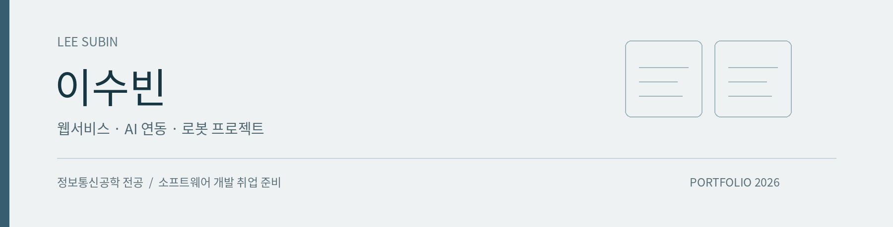
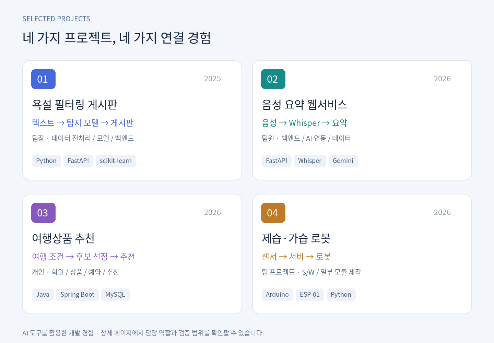

# 이수빈 · 소프트웨어 프로젝트 포트폴리오

대학 및 직업훈련 과정에서 진행한 프로젝트입니다. 개발에는 AI 도구를 활용했습니다.



## 프로젝트 바로가기

| 프로젝트 | 코드 구분 | 확인 범위 |
|---|---|---|
| 욕설 필터링 | 제출 소스 정리본 · 저장소 루트 | API 정상/욕설 예시, 빈 DB 실행 |
| [음성 요약](voice-reconstruction) | 보고서 기반 재구현 소스 | 5개 자동 테스트, Whisper 영어 샘플 1건 전사 확인 · Gemini 실호출 미검증 |
| [여행 추천](travel-reconstruction) | 보고서·가이드 기반 재구현 소스 | 빌드 및 10개 HTTP 확인 항목 통과 |
| [이동형 로봇](https://github.com/oioihoihoih/mobile-humidity-control-robot) | 팀 저장소 참고 | 본인 참여 범위는 S/W·일부 모듈 제작, 이동 확인 |

소스는 위 폴더에서 바로 확인할 수 있습니다. ZIP에도 같은 소스와 실행 안내를 포함했습니다. 빌드 산출물, 사용자 DB, API 키는 포함하지 않았습니다. 재구현은 당시 원본 코드나 당시 성과와 구분합니다.

## 욕설 필터링 게시판

2025년 1·2학기 / 4인 팀 / 팀장. 데이터 전처리, 모델 학습, 백엔드 개발을 담당했습니다.

FastAPI 게시판과 scikit-learn 탐지 API를 연결합니다. TF-IDF·로지스틱 회귀에 사전·정규식 후처리를 적용합니다. `swear_score`는 자체 규칙을 결합한 점수이며 정확도나 보정된 확률이 아닙니다.

### 실행 — Python 3.12 검증

```bash
python -m venv .venv
source .venv/bin/activate
# Windows PowerShell에서는 .venv\Scripts\Activate.ps1
pip install -r requirements.txt
python -m uvicorn detection_api:app --host 127.0.0.1 --port 8090
```

다른 터미널에서 같은 가상환경을 활성화한 뒤 실행합니다.

```bash
python -m uvicorn main:app --host 127.0.0.1 --port 8000
```

http://127.0.0.1:8000 에 접속합니다. 빈 DB는 자동 생성됩니다. 기존 회원·게시글 DB는 포함하지 않았습니다. 기본 필터링 설정은 `none`이며 `/detect` API로 별도 탐지 결과를 확인할 수 있습니다.

### 포트폴리오 정리 과정의 변경

- 빈 DB에서도 실행되도록 테이블 생성 후 마이그레이션하도록 순서를 수정했습니다.
- 정적 파일과 모델 경로를 소스 파일 위치 기준으로 고정했습니다.
- 모델이 없을 때 더미 결과를 반환하던 경로를 제거했습니다.
- 저장된 모델의 학습 버전(1.6.1)에 맞춰 scikit-learn 의존성을 수정했습니다. 원래 명세(1.3.2)에서는 추론 시 오류가 발생했습니다.
- 노트북 전용 nest_asyncio 의존성을 제거했습니다.

위 변경은 2026년 포트폴리오 정리 시 적용했으며 당시 프로젝트 성과로 소급하지 않습니다.

### 현재 한계

학습용 로컬 실행 프로젝트입니다. 비밀번호는 단순 SHA-256, 세션은 메모리 기반이며 관리자 권한을 사용자명 `system`으로 판별합니다. 운영 배포 전에는 관리자 가입 제한·별도 권한 체계, 비밀번호 저장, 세션 만료, CORS, 출력 인코딩 등을 개선해야 합니다.

사전은 문맥을 구분하지 못해 일반 단어도 잘못 탐지할 수 있습니다. 분리된 평가 데이터로 성능을 검증한 기록이 없어 정확도 수치를 기재하지 않습니다. 포함한 모델은 제출된 프로젝트 파일입니다.


## 음성 요약 · 여행 추천

2026년 1학기 프로젝트 자료를 근거로 2026-10-28에 재구현했습니다. 음성 요약은 팀원으로 백엔드·AI 연동·데이터 처리에 참여했고, 여행 추천은 개인 프로젝트입니다. 원본 소스가 확보되지 않아 구조와 기능을 재작성했으며 변경점은 각 폴더의 README에 정리했습니다.

## 로봇 프로젝트

직업훈련 팀 프로젝트에서 S/W와 일부 하드웨어 모듈 제작·탑재에 참여했습니다. 실제 이동 구동 확인과 전체 자율주행·제습·가습 완주 검증은 구분합니다. 팀 소스의 전체 기능을 개인 성과로 기재하지 않습니다.

구조도와 프로젝트 카드 이미지는 자료를 바탕으로 새로 구성한 설명 자료이며 실제 실행 화면이 아닙니다.
