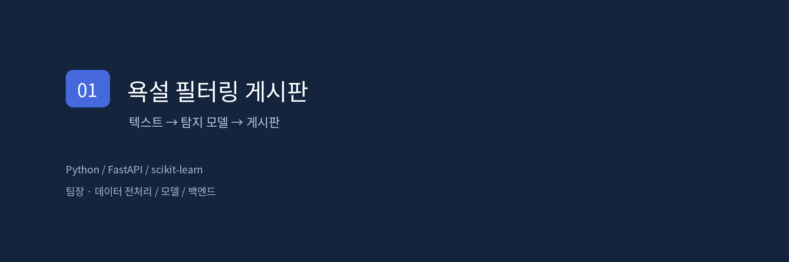
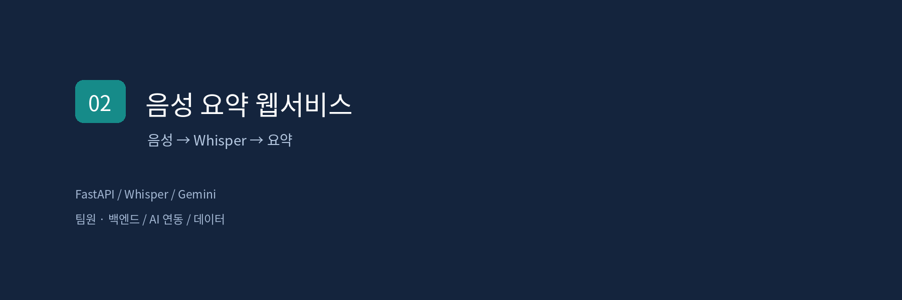
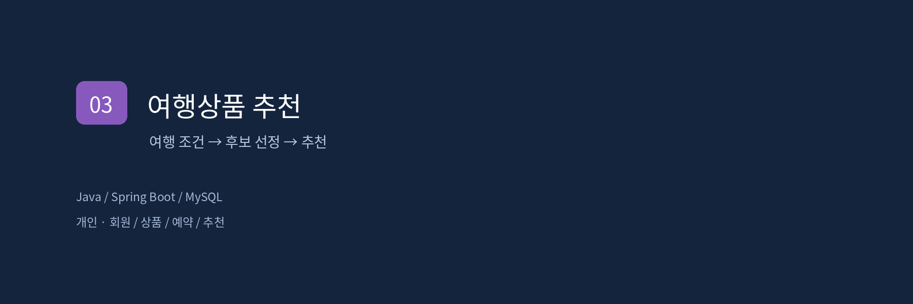
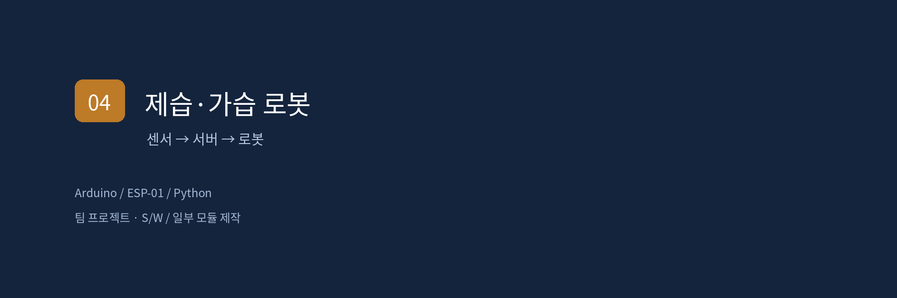

## 안녕하세요, 이수빈입니다.

정보통신공학을 전공하며 웹서비스에 AI 기능을 연결하는 프로젝트를 진행했습니다. 현재는 로봇 개발 교육을 받으며 소프트웨어와 센서를 함께 다루고 있습니다.

[노션 포트폴리오](https://app.notion.com/p/40656a83e78580f48be3cfbcc3b420d7) · [이메일](mailto:1001subin@gmail.com)

---

## 프로젝트

<table>
<tr>
<td width="50%" valign="top">
<a href="https://app.notion.com/p/01-40656a83e785806da1f2f7da22a2cc71"></a>
<h3>01 · 욕설 필터링 게시판</h3>
<p>2025 · 4인 팀 / 팀장</p>
<p>게시글의 욕설을 탐지하고 필터링하는 서비스입니다. 데이터 전처리, 모델 학습과 백엔드를 맡았습니다.</p>
<p><code>Python · FastAPI · scikit-learn</code></p>
<a href="https://app.notion.com/p/01-40656a83e785806da1f2f7da22a2cc71">프로젝트 소개 ↗</a> · <a href="main.py">코드 보기</a>
</td>
<td width="50%" valign="top">
<a href="https://app.notion.com/p/02-40656a83e78580d092e0d01270340e16"></a>
<h3>02 · 음성 요약 웹서비스</h3>
<p>2026 · 4인 팀 / 팀원</p>
<p>음성을 텍스트로 변환하고 요약 기록을 관리합니다. 백엔드와 AI 연동, 데이터 처리에 참여했습니다.</p>
<p><code>FastAPI · Whisper · Gemini</code></p>
<a href="https://app.notion.com/p/02-40656a83e78580d092e0d01270340e16">프로젝트 소개 ↗</a> · <a href="voice-reconstruction">코드 보기</a>
</td>
</tr>
<tr>
<td width="50%" valign="top">
<a href="https://app.notion.com/p/03-AI-40656a83e78580f2bb34f9f4650469ca"></a>
<h3>03 · 여행상품 추천 웹사이트</h3>
<p>2026 · 개인 프로젝트</p>
<p>여행 조건에 맞는 상품 추천부터 예약·취소까지 연결했습니다. AI 도구와 함께 웹서비스 전반을 구현했습니다.</p>
<p><code>Java · Spring Boot · MySQL</code></p>
<a href="https://app.notion.com/p/03-AI-40656a83e78580f2bb34f9f4650469ca">프로젝트 소개 ↗</a> · <a href="travel-reconstruction">코드 보기</a>
</td>
<td width="50%" valign="top">
<a href="https://app.notion.com/p/04-40656a83e7858060a4a9c97e45fd9558"></a>
<h3>04 · 이동형 제습·가습 로봇</h3>
<p>직업훈련 · 팀 프로젝트</p>
<p>소프트웨어 작성과 일부 하드웨어 모듈 제작·탑재에 참여했습니다. 실제 로봇의 이동을 확인했습니다.</p>
<p><code>Arduino · ESP-01 · Python</code></p>
<a href="https://app.notion.com/p/04-40656a83e7858060a4a9c97e45fd9558">프로젝트 소개 ↗</a> · <a href="https://github.com/oioihoihoih/mobile-humidity-control-robot">팀 저장소</a>
</td>
</tr>
</table>

개발에는 AI 도구를 활용했습니다. 음성 요약·여행 추천의 현재 코드는 보고서 기반 재구현입니다. 당시 작업과 이번 정리 과정의 변경점은 각 프로젝트 README에 구분해 적었습니다. 커버와 도식은 설명용 이미지입니다.

## 사용한 기술

| 분야 | 프로젝트에서 사용한 도구 |
| :--- | :--- |
| 웹서비스 | Python · FastAPI / Java · Spring Boot |
| 데이터·AI | SQLite · MySQL / scikit-learn · Whisper · Gemini API |
| 하드웨어 | Arduino · ESP-01을 활용한 일부 모듈 제작 |
| 영상·디자인 | Premiere Pro · Photoshop — 유튜브 외주 및 개인 작업 |

## 학력과 교육

**배재대학교 정보통신공학과**  
2020.03 입학 · 2027.02 졸업예정

**미래융합교육원 · 로보테크 AI 자율주행 로봇 개발자 과정**  
2026.07.21 ~ 2027.01.28 예정 · 수강 중

---

<details>
<summary><b>실행 방법과 검증 범위</b></summary>

| 프로젝트 | 확인한 내용 | 남은 검증·한계 |
| :--- | :--- | :--- |
| 욕설 필터링 | API 예시와 빈 DB 실행 | 별도 평가 데이터의 정확도 미측정 |
| 음성 요약 | 자동 테스트 5개, Whisper 영어 샘플 1건 실제 전사 | Gemini 실호출·한국어 정확도·장시간 음성 성능 미검증 |
| 여행 추천 | Maven 빌드, H2 환경 HTTP 확인 10개 | Gemini 실호출·MySQL·동시 예약 부하 미검증 |
| 이동형 로봇 | 실제 이동 구동 확인 | 전체 자율주행·제습·가습 완주와 구분 |

음성 요약과 여행 추천의 실행 방법은 각 소스 폴더의 README에 있습니다. 빈 키·예시 키에서는 Gemini를 호출하지 않고 대체 동작을 표시합니다. ZIP은 같은 소스의 다운로드용 묶음입니다.

## 욕설 필터링 게시판

2025년 1·2학기 / 4인 팀 / 팀장. 데이터 전처리, 모델 학습, 백엔드 개발을 담당했습니다.

FastAPI 게시판과 scikit-learn 탐지 API를 연결합니다. TF-IDF·로지스틱 회귀에 사전·정규식 후처리를 적용합니다. `swear_score`는 자체 규칙을 결합한 점수이며 정확도나 보정된 확률이 아닙니다.

### 실행 — Python 3.12 검증

```bash
python -m venv .venv
source .venv/bin/activate
# Windows PowerShell에서는 .venv\Scripts\Activate.ps1
pip install -r requirements.txt
python -m uvicorn detection_api:app --host 127.0.0.1 --port 8090
```

다른 터미널에서 같은 가상환경을 활성화한 뒤 실행합니다.

```bash
python -m uvicorn main:app --host 127.0.0.1 --port 8000
```

http://127.0.0.1:8000 에 접속합니다. 빈 DB는 자동 생성됩니다. 기존 회원·게시글 DB는 포함하지 않았습니다. 기본 필터링 설정은 `none`이며 `/detect` API로 별도 탐지 결과를 확인할 수 있습니다.

### 포트폴리오 정리 과정의 변경

- 빈 DB에서도 실행되도록 테이블 생성 후 마이그레이션하도록 순서를 수정했습니다.
- 정적 파일과 모델 경로를 소스 파일 위치 기준으로 고정했습니다.
- 모델이 없을 때 더미 결과를 반환하던 경로를 제거했습니다.
- 저장된 모델의 학습 버전(1.6.1)에 맞춰 scikit-learn 의존성을 수정했습니다. 원래 명세(1.3.2)에서는 추론 시 오류가 발생했습니다.
- 노트북 전용 nest_asyncio 의존성을 제거했습니다.

위 변경은 2026년 포트폴리오 정리 시 적용했으며 당시 프로젝트 성과로 소급하지 않습니다.

### 현재 한계

학습용 로컬 실행 프로젝트입니다. 비밀번호는 단순 SHA-256, 세션은 메모리 기반이며 관리자 권한을 사용자명 `system`으로 판별합니다. 운영 배포 전에는 관리자 가입 제한·별도 권한 체계, 비밀번호 저장, 세션 만료, CORS, 출력 인코딩 등을 개선해야 합니다.

사전은 문맥을 구분하지 못해 일반 단어도 잘못 탐지할 수 있습니다. 분리된 평가 데이터로 성능을 검증한 기록이 없어 정확도 수치를 기재하지 않습니다. 포함한 모델은 제출된 프로젝트 파일입니다.


</details>

<details>
<summary><b>저장소 구성</b></summary>

- `main.py`, `detection_api.py`, `static/`, 모델 파일: 욕설 필터링 제출 소스 정리본
- `voice-reconstruction/`: 음성 요약 재구현 코드·테스트·실행 안내
- `travel-reconstruction/`: 여행 추천 재구현 코드·검증 스크립트·실행 안내
- `*.png`: 포트폴리오 커버와 설명용 도식
- `*-reconstruction.zip`: 재구현 소스 다운로드용 압축본

사용자 DB와 실제 API 키는 포함하지 않았습니다. 로봇 팀 저장소의 전체 기능을 개인 성과로 기재하지 않습니다.

</details>

**연락** · [1001subin@gmail.com](mailto:1001subin@gmail.com)  
대전 · 서울 · 경기 근무 희망 / 입사 시기 협의 가능
